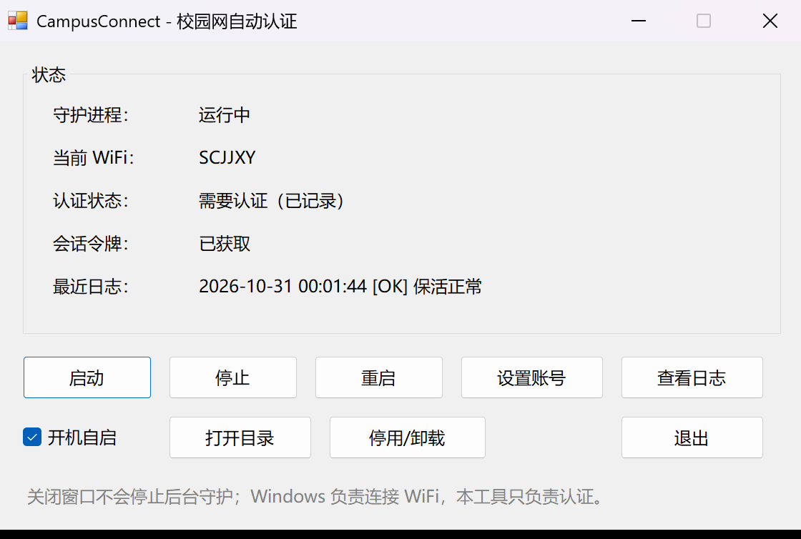

# 四川大学锦江学院校园网自动认证工具

Windows 10/11 免安装、无控制台、带图形界面的校园网（锐捷 ePortal）自动认证与保活工具。



## 功能

- **图形界面**：启动 / 停止 / 重启、设置账号、开机自启、查看日志、打开目录、停用/卸载
- **无控制台**：`CampusConnect.vbs` 隐藏启动 PowerShell GUI；`CampusConnect.cmd` 是兼容入口
- **不主动连接 WiFi**：连接哪个 WiFi 由 Windows 决定，本工具只读取当前 SSID 并按需认证
- **按 SSID 缓存**：新 WiFi 只探测一次；需要认证的自动登录，不需要认证的写入 `wifi-cache.json` 后跳过
- **切换即登录**：检测到 SSID 变化后立即尝试登录，不等旧 token 的保活超时；门户请求 8 秒硬超时，避免切换瞬间卡住
- **断线保活**：约 20 秒一次心跳，掉线/令牌失效时自动重新认证
- **密码保护**：使用 Windows DPAPI 加密保存，仅当前 Windows 用户可解密
- **高 DPI**：Per-Monitor V2，200% 缩放下主窗口和设置窗口都不会裁切
- **无需管理员权限**，无需安装 PowerShell 7

## 快速开始

1. 打开 [Releases](https://github.com/FL411/SCUJJ-CampusConnect/releases/latest)，下载 `CampusConnect.zip`；
2. 解压到任意目录（不要只复制单个文件）；
3. 双击 `CampusConnect.vbs`（推荐，无控制台；`CampusConnect.cmd` 也可以）；
4. 首次打开会弹出“设置账号”，输入学号和密码，保存；
5. 勾选“开机自启”，点“启动”。

关闭窗口不会停止后台守护。要停止时用界面上的“停止”或“停用/卸载”。

> 如果移动了整个文件夹，重新勾选一次“开机自启”，让 HKCU Run 指向新路径。

## 界面按钮

| 按钮 | 作用 |
|---|---|
| 启动 / 停止 / 重启 | 控制后台守护进程 |
| 设置账号 | 修改学号、密码、门户地址 |
| 查看日志 | 打开 `rea-daemon.log` |
| 打开目录 | 打开程序所在文件夹 |
| 开机自启 | 写入/删除 HKCU Run |
| 停用/卸载 | 停止守护 + 移除开机自启；之后删除文件夹即可 |
| 退出 | 只关闭窗口，不停止后台守护 |

## 工作原理

1. 读取当前 WiFi SSID（只读，不扫描、不连接、不切换）。
   - 重连瞬间的 `正在识别...` / `Identifying...` 会被忽略，不写入缓存。
2. 对每个新 SSID 探测一次学校门户：
   - 302 跳转，或 200 + `top.self.location.href='...'` 跳到学校门户 → 需要认证，自动登录；
   - 正常 204/内容 → 不需要认证，写入 `wifi-cache.json`，同一 SSID 下次跳过；
   - 超时/无响应 → 视为内网（例如 `SCUJJ-IT-1/2` 特殊教室），记录为无需认证并跳过。
3. 名称包含 `SCJJXY` 的 WiFi 作为认证候选，避免每连一个新 WiFi 都重复检测。
4. 登录成功后定时 `keepalive`；token 失效时从门户 success 跳转重新获取。
5. 需要认证时使用保存的账号密码自动登录。

门户地址默认 `http://10.130.128.9`。

## 文件说明

| 文件 | 说明 |
|---|---|
| `CampusConnect.vbs` | 推荐启动器：无控制台，隐藏启动 GUI |
| `CampusConnect.cmd` | 兼容启动器：调用 VBS，cmd 窗口会闪一下 |
| `CampusConnect.ps1` | WinForms 主界面 |
| `rea-daemon.ps1` | 后台守护：SSID 检测、认证、保活 |
| `rea-daemon-watchdog.vbs` | 无窗口看门狗：守护退出后自动重启 |
| `rea-connect.ps1` | 手动登录/配置工具（排查用） |
| `rea-keepalive.ps1` | 独立保活脚本（排查用） |
| `build-package.ps1` | 从源码构建 `dist/CampusConnect.zip` |
| `README.txt` | 随包分发的简明使用说明 |
| `CHANGELOG.md` | 版本变更记录 |
| `docs/screenshot.png` | 界面截图 |

运行时生成、**不应提交**的文件：

- `rea-connect.config.json`：账号、DPAPI 密码密文、token
- `rea-daemon.log`：运行日志
- `wifi-cache.json`：按 SSID 的认证缓存
- `CampusConnect-gui.log`：GUI 异常日志（仅出错时生成）

## 从源码构建

```powershell
# Windows PowerShell 5.1
powershell.exe -NoProfile -ExecutionPolicy Bypass -File .\build-package.ps1
```

输出：`dist\CampusConnect.zip`（8 个文件，不含个人配置/日志/缓存）。

## 安全与隐私

- 仓库和分享包都不包含任何个人账号、密码、token、日志或 WiFi 缓存；
- 密码使用 Windows DPAPI（CurrentUser）加密，换 Windows 用户无法解密；
- 门户是 HTTP 明文；如果使用代理/TUN，建议把 `10.130.128.9` 设为 DIRECT，避免认证流量被代理；
- 本工具不会主动连接/切换 WiFi，也不会修改系统网络配置（除 HKCU Run 自启项）；
- 请只用于自己的账号，并遵守学校网络管理规定。

## 常见问题

**需要手动填 WiFi 名称吗？**

不需要。工具只读当前 SSID；名称含 `SCJJXY` 的作为认证候选，其他 WiFi 由门户探测结果决定。

**连到不需要认证的 WiFi 会怎样？**

首次探测后写入 `wifi-cache.json`，以后同一 SSID 直接跳过，不重复登录。

**想重新检测某个 WiFi？**

删除程序目录下的 `wifi-cache.json`，重新启动守护即可。

**关闭窗口后还在认证吗？**

在。关闭的只是 GUI；后台守护由 `wscript.exe` + 隐藏的 PowerShell 运行。要停止请点“停止”或“停用/卸载”。

**需要管理员权限吗？**

不需要。自启写在当前用户的 HKCU Run。

**支持 Windows 7 吗？**

不保证。目标环境是 Windows 10/11 + Windows PowerShell 5.1。

## 免责声明

本项目是个人学习/自用工具，与四川大学锦江学院及网络服务提供商无关。使用前请确认符合学校网络使用规定；因使用本工具产生的任何后果由使用者自行承担。

## License

[MIT](LICENSE)
